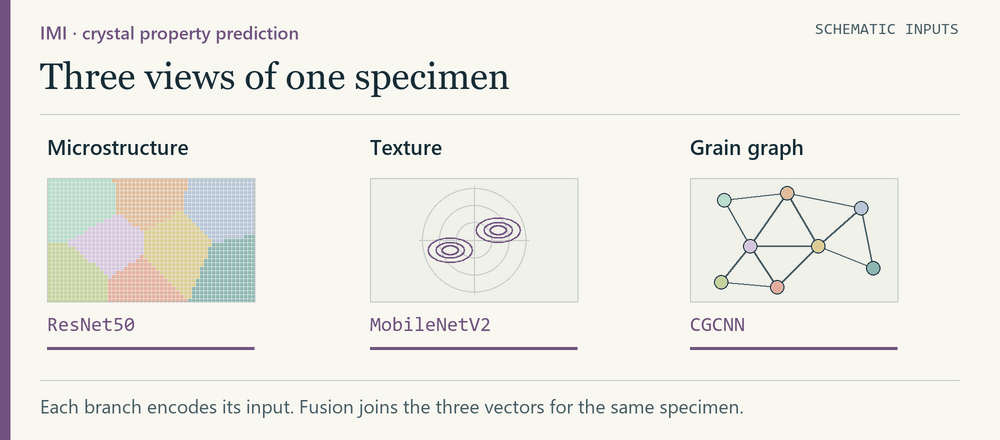

# IMI · Multimodal crystal property prediction

A microstructure image shows how grains meet. A texture image describes their orientations. A graph makes their connections explicit. This project studies how much those three views of the same specimen can tell us about its material properties.

<picture>
  <source media="(prefers-reduced-motion: reduce)" srcset="docs/readme-media/workflow.png">
  
</picture>

The three drawings represent views of a single specimen. [View the still figure](docs/readme-media/workflow.png)

## Three representations of one specimen

| Input | Model branch | Information it carries |
| --- | --- | --- |
| Electron backscatter diffraction (EBSD) microstructure image | ResNet50 | Spatial features of the microstructure |
| Crystallographic texture image | MobileNetV2 | Patterns in the orientation distribution |
| Grain-boundary graph | CGCNN | Local connectivity and neighboring features |

The branches produce feature vectors. The fusion network combines them into a specimen-level representation for the property predictor. Specimen identity matters here. A correctly shaped texture image from a different sample would still describe the wrong material. The project includes a Flask API and a React interface for exploring its outputs.

## Try a small input check

This Python example can run in a notebook or a Python 3 shell. It illustrates the alignment assumption before a fusion model ever sees a tensor. The specimen identifiers are invented for the example.

~~~python
image_ids = {"sample-01", "sample-02", "sample-03"}
texture_ids = {"sample-01", "sample-03"}
graph_ids = {"sample-01", "sample-02", "sample-03"}

complete = image_ids & texture_ids & graph_ids
print(sorted(complete))
print("Missing texture:", sorted((image_ids | graph_ids) - texture_ids))
~~~

The complete inputs belong to `sample-01` and `sample-03`. For `sample-02`, the texture view is missing. This example checks identity only. Orientation conventions, scale and units still matter when preparing real inputs.

## Reading a prediction

Keep neural predictions separate from quantities calculated with a physics relation. A measured specimen property can validate a prediction. A number derived from that same prediction cannot serve as an independent reference. For a comparison across models, keep all views of one specimen in one split and report error separately for each property and unit.

The animation illustrates how the branches meet. It uses schematic inputs and carries no accuracy or performance claim. [Project repository](https://github.com/Bhargav12-surya/DL_IMI_ETP)
